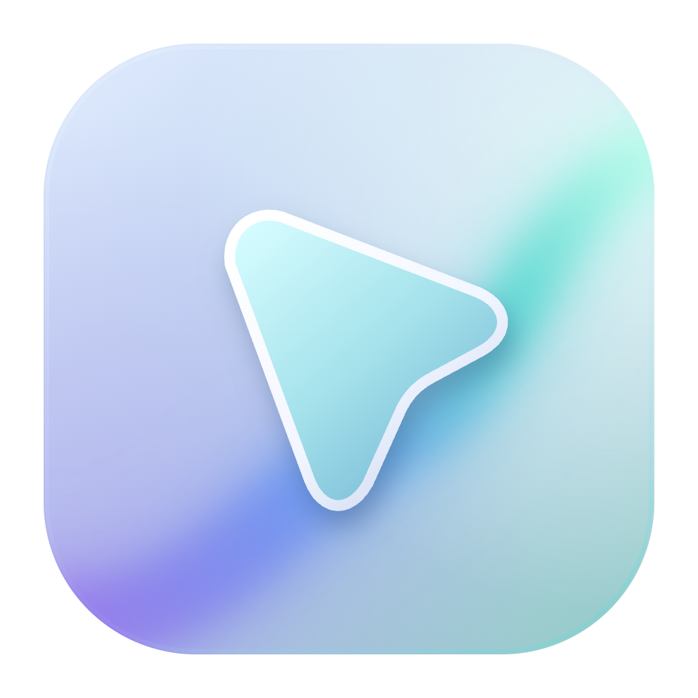
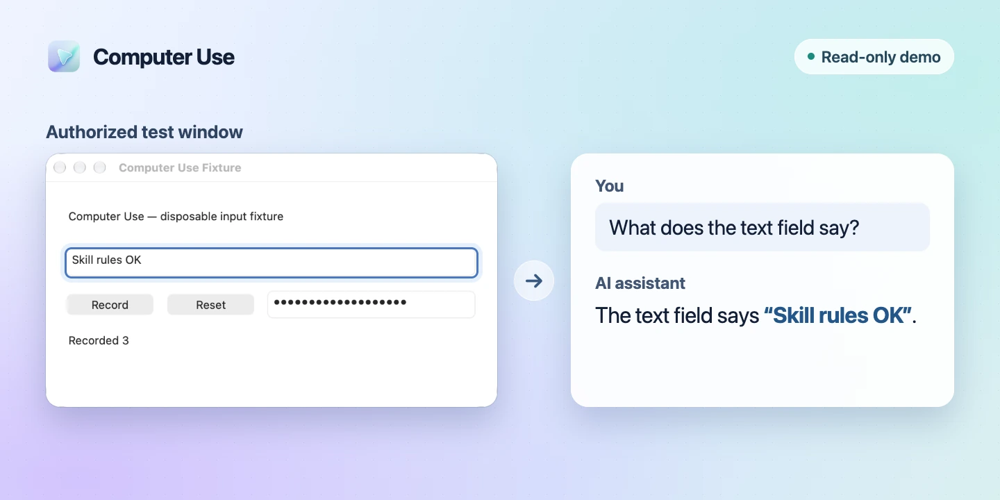

  

<h1 align="center">Computer Use</h1>

  <strong>Let the AI assistant you already use work with your desktop apps</strong> 
  It can see the windows you allow, click buttons, and fill in forms. Actions run in the background by default.

  <strong><a href="https://github.com/starroyhq/computer-use/releases/latest">Download the latest version</a></strong> ·
  <a href="README.md">简体中文</a>

## Get started in three steps

1. **Download and open Computer Use.** Under **Assets**, choose the file ending in `macos-arm64.dmg` for a Mac with Apple silicon (macOS 14+) and drag the app to Applications. On Windows, choose a `setup.exe` installer for x64 (Intel or AMD) or ARM64 (Windows on Arm). Windows installers are unsigned and may trigger a [system warning](docs/WINDOWS.en.md#install-and-uninstall).
2. **Connect your AI assistant.** On macOS, grant Accessibility and Screen Recording permissions. Open **Connect**, choose **Copy Installation Prompt** (**Copy setup prompt** on Windows), and paste it into your assistant so it can install the Skill it needs to connect. Review the pairing request in the app before approving it. It covers current and future desktop apps and windows by default, and can be limited to specific apps.
3. **Try a read-only task.** Open Notepad or TextEdit, type a line of sample text, then ask your assistant: “Use Computer Use to read the test window I just opened and tell me what it says.”

   
  Read-only demo with a captured test window and an example reply

You can pause, revoke access, or use Emergency Stop in the app at any time.

The app includes what it needs to run. Setup has been tested with Codex.

## More help

[Usage and troubleshooting](docs/USAGE.md) · [Advanced setup (Skill, MCP, CLI)](docs/USAGE.md#app--skill-双向接入--bidirectional-onboarding) · [npm / pnpm](docs/NPM.md) · [Development and builds](scripts/README.md) · [Platform testing](docs/validation-results.md)

Licensed under [MIT](LICENSE). Desktop control uses [Cua Driver](https://github.com/trycua/cua). [Third-party notices](THIRD_PARTY_NOTICES.md)
