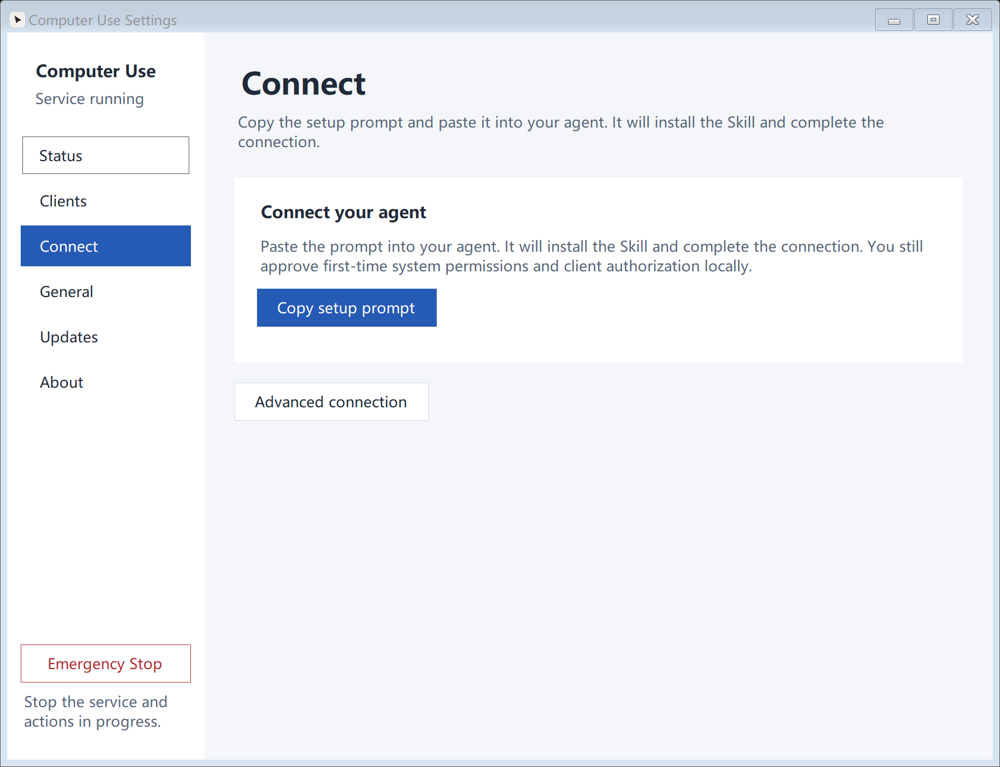

<p align="center">
  
</p>

<h1 align="center">Computer Use</h1>

<p align="center">
  <strong>Let your Agent see and operate your computer.</strong><br />
  Native macOS &amp; Windows hosts · MCP / CLI integration · Background execution by default
</p>

<p align="center">
  <a href="https://github.com/starroyhq/computer-use/releases/latest"></a>
  <a href="https://github.com/starroyhq/computer-use/actions/workflows/ci.yml"></a>
  <a href="#platforms-and-validation"></a>
  <a href="LICENSE"></a>
</p>

<p align="center">
  <a href="#install-a-release">Download</a> ·
  <a href="#connect-an-agent-and-observe">Get started</a> ·
  <a href="#documentation">Documentation</a> ·
  <a href="README.md">简体中文</a>
</p>

Computer Use adds desktop control to the Agent you already use: **your Agent understands the task and plans the steps; Computer Use executes authorized actions locally.** Install the App and copy a setup prompt to let your Agent install the Skill and connect. No repository clone or global Node installation is needed.

<p align="center">
  
</p>
<p align="center"><sub>macOS Connect page, shown in Chinese · Copy a prompt and let your Agent handle setup</sub></p>

<details>
<summary>See the Windows interface</summary>

<p align="center">
  
</p>

Native Windows interface, shown with UI test fixture data. [Screenshot sources](docs/assets/README.md)

</details>

## Install a release

**Currently a development preview.** Download v0.7.0 below, or visit [Releases](https://github.com/starroyhq/computer-use/releases/latest) for the latest version, portable ZIPs and checksums.

| System | Download | Installation |
| --- | --- | --- |
| **macOS · Apple Silicon** | [Download DMG](https://github.com/starroyhq/computer-use/releases/download/v0.7.0/computer-use-0.7.0-macos-arm64.dmg) | macOS 14+; drag to Applications and open |
| **Windows · x64** | [Download installer](https://github.com/starroyhq/computer-use/releases/download/v0.7.0/computer-use-0.7.0-windows-x64-setup.exe) | Installs for the current user; no administrator rights needed |
| **Windows · ARM64** | [Download installer](https://github.com/starroyhq/computer-use/releases/download/v0.7.0/computer-use-0.7.0-windows-arm64-setup.exe) | For Windows on ARM devices |

Official macOS packages are Developer ID signed and Apple notarized. Windows packages are currently unsigned and may be blocked by SmartScreen, Smart App Control or system policy; on-demand startup does not bypass those restrictions. Windows compatibility targets **Windows 10 1809+**; see [platforms and validation](#platforms-and-validation) for tested coverage.

With Node.js 22+, you can also use the [npm launcher](https://www.npmjs.com/package/@starroy/computer-use):

```sh
npx @starroy/computer-use setup
# Or: pnpm dlx @starroy/computer-use setup
```

It finds or verifies and installs the official App, then prints a setup prompt for your Agent. System permissions and first pairing approval still happen locally. Existing installations, profiles and paused states are preserved. See [npm / pnpm setup](docs/NPM.md) (Chinese).

## Connect an agent and observe

### 1. Open the App and grant system permissions

On macOS, open Settings from the menu bar and grant Computer Use **Accessibility** and **Screen Recording** permissions under Status, then quit and reopen as prompted. On Windows, launch it from the Start menu and open Settings from the tray. The host must run in the current user's interactive desktop session.

### 2. Copy the prompt to your Agent

Go to **Settings → Connect → Copy setup prompt** and paste it into your Agent. The Agent follows the prompt to retrieve the complete Skill, check the local App and configure its connection. You do not need to choose a Skill directory manually. Approve the first pairing request locally in the App.

The default profile is `default`; existing pairings are preserved. **New pairings authorize all desktop applications with one approval**, including future applications and windows, and persist across host restarts. Existing restricted pairings keep their scope. Profile selection and manual MCP configuration are under Advanced connection.

### 3. Verify a real observation first

Open a test window, such as a blank TextEdit or Notepad document, and ask your Agent:

> Use computer-use to check the connection, list authorized windows, open a session for the test window, capture and describe its screenshot, then close the session. Do not click or type during this task.

Confirm that you receive a real window screenshot before trying typing or clicks. Integration depends on your Agent's support for Skills, MCP or CLI. Codex integration has been tested; actual Skill installation by other Agents remains unverified.

<details>
<summary>Manual setup: CLI, MCP or a standalone SKILL.md</summary>

**macOS CLI:** choose Install in ~/.local/bin… on General and make sure that directory is in your terminal's `PATH`; alternatively, invoke `Contents/Resources/bin/computer-use` inside the App directly. For **Windows CLI** commands, see the [Windows guide](docs/WINDOWS.en.md).

These commands are for a `default` profile that has not been paired. Check an existing profile's status first; do not delete credentials or pair again unnecessarily.

```sh
computer-use preflight --profile default
computer-use pair --profile default --name 'My Agent'
# After approving the pairing in the App:
computer-use doctor --profile default
computer-use targets --profile default
computer-use config codex --profile default
```

Add the TOML from `config codex` to Codex's `~/.codex/config.toml` and reload MCP. Other MCP clients can use `config stdio --profile default` for generic JSON. The configuration contains absolute paths and a profile, not credentials; this project does not edit Agent configuration automatically. See the [Codex configuration guide](https://learn.chatgpt.com/docs/extend/mcp?surface=cli).

**Starting with just a Skill:** give the complete [SKILL.md](skills/computer-use/SKILL.md) to your Agent. It describes how to discover an existing App or verify and install an official release, then complete local authorization and an observation check. The Skill is self-contained, needs no adjacent scripts or global Node, and includes compatibility guidance for v0.6.1 commands. The installed App's `instructions` command provides the current guide. See [bidirectional onboarding](docs/USAGE.md#app--skill-双向接入--bidirectional-onboarding).

</details>

## What it can do

| Capability | How it works |
| --- | --- |
| **Observe the desktop** | List windows, capture screenshots and read accessibility elements so the Agent can act on the actual interface |
| **Operate applications** | Click, type, send hotkeys, scroll and drag in a straight line; support depends on the platform and control |
| **Run in the background** | Background mode is the default; complete packages can start the service on the first actual CLI / stdio MCP call |
| **Connect your existing Agent** | Use a Skill, stdio MCP or the standalone CLI; local HTTP MCP is optional |
| **Use a separate browser** | Control isolated headless Chromium through Playwright with a separate grant, without inheriting your everyday browser's login state |
| **Check action outcomes** | Track actions with snapshots and request IDs; query and observe uncertain outcomes without automatically replaying actions |

Manage service status, paired clients and updates in the native App. Release builds check for updates daily by default and verify SHA-256 checksums and release metadata before installation. macOS supports in-place updates after signature verification; installed Windows copies update through the setup wizard. See [updates](docs/USAGE.md#检查更新--updates).

## Control stays with you

| Control | Effect |
| --- | --- |
| **Initial pairing approval** | Authorizes a client for all desktop applications by default, with optional explicit scope restrictions |
| **Pause** | Blocks new actions until you resume locally in the App |
| **Revoke a client** | Removes that client's authorization from the Clients page |
| **Emergency stop** | Stops execution services until you restart them locally in the App |

**Pause and emergency stop persist across exit, reopening, login and updates.** Agent calls and background startup cannot clear these states.

Pairing includes permission for foreground actions, while execution defaults to background mode and **never switches to foreground mode automatically**. Background support depends on the application and control; it cannot guarantee zero focus changes. Source execution, custom sockets and remote HTTP do not start the host automatically.

HTTP is off by default and listens only on loopback when enabled; cross-machine connections use a manual SSH tunnel. Default action logs exclude screenshots, typed text, URLs and window titles; CLI screenshots are saved locally. Screenshots and results sent to a cloud Agent are still processed by your chosen model provider. See [permissions and action limits](docs/USAGE.md).

## Platforms and validation

| Platform | Current status |
| --- | --- |
| **macOS Apple Silicon** | Native App available; local builds tested across applications and windows, including authorization controls |
| **Windows ARM64** | Installer and portable package available; limited desktop acceptance in a Windows 11 ARM64 VM |
| **Windows x64** | Separate build available; native x64 desktop acceptance pending |
| **macOS Intel / Linux** | No host package available |

Windows 10 has not been tested. Desktop records cover local builds and specific test applications, not every published artifact or arbitrary third-party application. Fresh-system installation and actual Skill installation by other Agents have not been fully validated. See the [validation results](docs/validation-results.md) and [v0.7.0 onboarding validation](docs/validation-skill-link-20261012.md).

## Development

For everyday use, install the App above. To work on the project, install **Git, Node 24+ and pnpm 10**, then get the source:

```sh
git clone https://github.com/starroyhq/computer-use.git
cd computer-use
pnpm install --frozen-lockfile
pnpm check
```

<details>
<summary>Build the macOS / Windows host from source</summary>

**macOS** also requires Apple Silicon, macOS 14+ and the Xcode / Swift toolchain:

```sh
pnpm native:test
pnpm package:app
open 'artifacts/Computer Use.app'
```

Source builds use ad-hoc development signing by default, unlike signed and notarized releases. Changing the signature or application identifier may require new system permission grants. Do not replace the App while it is running.

**Windows** also requires the .NET 10 SDK. Run in PowerShell:

```powershell
node scripts/package-windows.mjs --arch x64
& '.\artifacts\Computer Use Windows x64\ComputerUse.WindowsHost.exe'
```

For ARM64, use `--arch arm64` and the output directory `Computer Use Windows ARM64`. Complete packages bundle their runtimes; users do not need the build SDKs.

Browser integration tests need matching Chromium, installed with `pnpm exec playwright install chromium`. Tests skipped because components are missing do not count as passes. See [building and packaging](scripts/README.md) and [CI](docs/CI.md) for the full workflow.

</details>

## Documentation

| Document | Contents |
| --- | --- |
| [Usage](docs/USAGE.md) | CLI, Skill setup, authorization scopes, browser, action semantics and troubleshooting |
| [Windows guide](docs/WINDOWS.en.md) | Installation, local MCP, Mac access over SSH and pause protection |
| [npm / pnpm setup](docs/NPM.md) | `@starroy/computer-use` launcher, App discovery and publishing setup (Chinese) |
| [CLI Skill](skills/computer-use/SKILL.md) | Complete installation and operation guide for your Agent |
| [Architecture](docs/ARCHITECTURE.md) | Hosts, authorization, sessions, snapshots and backend adapters |
| [Building and packaging](scripts/README.md) · [CI](docs/CI.md) | Local builds, platform checks, signing and releases |
| [Validation procedure](docs/VALIDATION.md) · [Results](docs/validation-results.md) | Test steps, covered behavior and outstanding checks |
| [Roadmap](docs/ROADMAP.md) | Project direction and next steps |

## License and acknowledgments

Original source and documentation are [MIT](LICENSE)-licensed, copyright Starroy; see [NOTICE](NOTICE). Desktop operations use [Cua Driver](https://github.com/trycua/cua), the isolated browser uses [Playwright](https://github.com/microsoft/playwright), and MCP uses the official TypeScript SDK. This project implements the native hosts, authorization, session and snapshot management, action records, CLI / MCP integration and packaging. Dependencies retain their own licenses; see [third-party notices](THIRD_PARTY_NOTICES.md).
