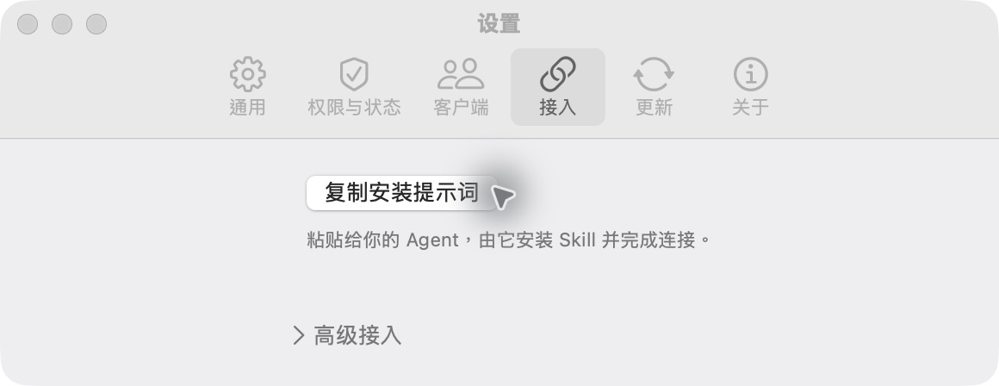
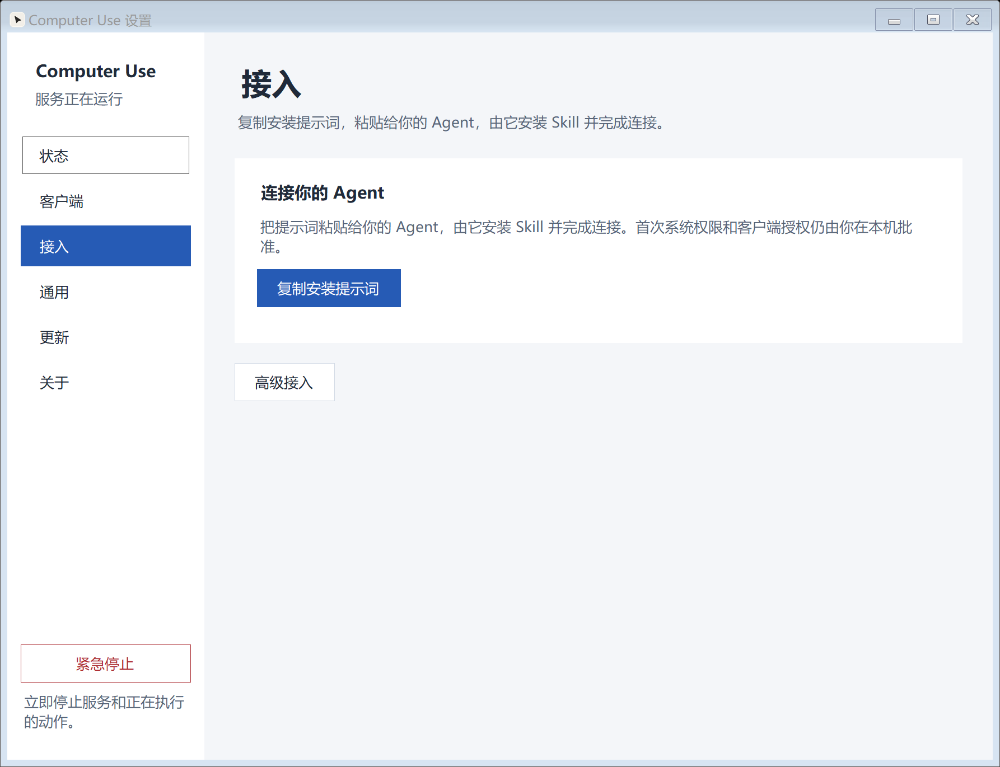

<p align="center">
  
</p>

<h1 align="center">Computer Use</h1>

<p align="center">
  <strong>让你的 Agent，直接观察和操作电脑。</strong><br />
  macOS 与 Windows 原生宿主 · MCP / CLI 接入 · 默认后台执行
</p>

<p align="center">
  <a href="https://github.com/starroyhq/computer-use/releases/latest"></a>
  <a href="https://github.com/starroyhq/computer-use/actions/workflows/ci.yml"></a>
  <a href="#平台与验证"></a>
  <a href="LICENSE"></a>
</p>

<p align="center">
  <a href="#安装正式版">下载安装</a> ·
  <a href="#接入-agent-与首次观察">三步接入</a> ·
  <a href="#文档导航">使用文档</a> ·
  <a href="README.en.md">English</a>
</p>

Computer Use 把桌面能力交给你已经在用的 Agent：**Agent 理解任务、规划步骤，Computer Use 在本机执行已授权的操作。** 安装 App，复制一段提示词，就可以让 Agent 按说明安装 Skill 并连接；无需克隆仓库或安装全局 Node。

<p align="center">
  
</p>
<p align="center"><sub>macOS 接入页 · 复制提示词，把后续接入步骤交给 Agent</sub></p>

<details>
<summary>查看 Windows 界面</summary>

<p align="center">
  
</p>

Windows 原生界面，截图使用 UI 测试演示数据。[截图来源](docs/assets/README.md)

</details>

## 安装正式版

**当前为开发预览版。** 下载 v0.7.0 安装包，或前往 [Releases](https://github.com/starroyhq/computer-use/releases/latest) 查看最新版本、便携 ZIP 与校验文件。

| 系统 | 下载 | 安装方式 |
| --- | --- | --- |
| **macOS · Apple Silicon** | [下载 DMG](https://github.com/starroyhq/computer-use/releases/download/v0.7.0/computer-use-0.7.0-macos-arm64.dmg) | macOS 14+；拖入“应用程序”后打开 |
| **Windows · x64** | [下载安装程序](https://github.com/starroyhq/computer-use/releases/download/v0.7.0/computer-use-0.7.0-windows-x64-setup.exe) | 当前用户安装，无需管理员权限 |
| **Windows · ARM64** | [下载安装程序](https://github.com/starroyhq/computer-use/releases/download/v0.7.0/computer-use-0.7.0-windows-arm64-setup.exe) | Windows on ARM 设备使用 |

macOS 正式包已使用 Developer ID 签名并经过 Apple 公证。Windows 包目前未签名，可能被 SmartScreen、Smart App Control 或系统策略拦截，按需启动不会绕过这些限制。Windows 兼容目标为 **Windows 10 1809+**，实测范围见[平台与验证](#平台与验证)。

## 接入 Agent 与首次观察

### 1. 打开 App，完成系统授权

macOS 从菜单栏打开设置，在“权限与状态”中授予 Computer Use **辅助功能**和**屏幕录制**权限，按提示退出并重新打开。Windows 从开始菜单启动，托盘中可打开设置；宿主应运行在当前用户的交互桌面。

### 2. 复制提示词，交给你的 Agent

进入 **设置 → 接入 → 复制安装提示词**，粘贴到你使用的 Agent。Agent 根据提示词获取完整 Skill、检查本机 App 并配置连接；你无需手动选择 Skill 目录。首次配对仍需你在 App 内批准。

默认使用 `default` profile；已有配对会被保留。**新配对默认一次授权所有桌面应用**，之后切换应用、新建窗口、重启宿主都不需要重复批准。旧受限配对不会自动扩权。profile 选择和手动 MCP 配置在“高级接入”中。

### 3. 先完成一次真实观察

打开一个测试窗口，例如空白的 TextEdit 或记事本文档，让 Agent 执行：

> 使用 computer-use 检查连接，列出已授权窗口，打开测试窗口的会话，获取截图并描述看到的内容，然后关闭会话。此次不要点击或输入。

确认拿到真实窗口截图后，再尝试输入和点击。Agent 的接入能力取决于它对 Skill、MCP 或 CLI 的支持；目前已有 Codex 接入记录，其他 Agent 的实际 Skill 安装仍待验证。

<details>
<summary>手动接入：CLI、MCP，以及只有 SKILL.md 的情况</summary>

**macOS CLI**：在“通用”页选择“安装到 ~/.local/bin…”，并确保该目录在终端的 `PATH` 中；也可直接调用 App 内的 `Contents/Resources/bin/computer-use`。**Windows CLI** 的调用方式见 [Windows 指南](docs/WINDOWS.md)。

以下命令用于尚未配对的 `default` profile；已有 profile 先检查状态，不要删除凭据或重复配对：

```sh
computer-use preflight --profile default
computer-use pair --profile default --name 'My Agent'
# 在 App 内批准配对后：
computer-use doctor --profile default
computer-use targets --profile default
computer-use config codex --profile default
```

将 `config codex` 输出的 TOML 加入 Codex 的 `~/.codex/config.toml` 并重新加载 MCP；其他 MCP 客户端使用 `config stdio --profile default` 获取通用 JSON。配置包含绝对路径和 profile，不含凭据，项目不会自动修改 Agent 配置。详见 [Codex 配置文档](https://learn.chatgpt.com/docs/extend/mcp?surface=cli)。

**只有 Skill 也可以开始**：将完整 [SKILL.md](skills/computer-use/SKILL.md) 交给 Agent，按其中流程发现已有 App，或校验并安装官方发布包，再完成本机授权与观察验证。Skill 自包含，不依赖旁边的脚本或全局 Node；兼容 v0.6.1 的旧命令。已安装 App 的 `instructions` 提供当前版本指南。详见[双向接入说明](docs/USAGE.md#app--skill-双向接入--bidirectional-onboarding)。

</details>

## 可以做什么

| 能力 | 使用方式 |
| --- | --- |
| **观察桌面** | 列出窗口、获取截图和辅助功能元素，让 Agent 根据真实界面操作 |
| **操作应用** | 点击、输入、快捷键、滚动与直线拖拽，具体支持取决于平台和控件 |
| **后台执行** | 默认后台模式；完整安装包可在首次 CLI / stdio MCP 实际调用时按需启动服务 |
| **连接现有 Agent** | 使用 Skill、stdio MCP 或独立 CLI；可选本机 HTTP MCP |
| **独立浏览器** | 通过 Playwright 操作独立的 headless Chromium，需单独授权，不继承日常浏览器登录状态 |
| **核对操作结果** | 使用快照和请求 ID 追踪动作；结果不确定时先查询、再观察，不自动重放 |

日常状态、已配对客户端和更新都在原生 App 中管理。正式版默认每天检查一次更新，安装前校验 SHA-256 与发布元数据；macOS 支持验证签名后原位更新，Windows 安装版通过安装向导更新。见[更新说明](docs/USAGE.md#检查更新--updates)。

## 控制权留在本机

| 控制 | 效果 |
| --- | --- |
| **首次配对批准** | 授权指定客户端；默认覆盖所有桌面应用，也可显式限定范围 |
| **暂停** | 阻止新动作，待你在 App 内恢复 |
| **撤销客户端** | 在“客户端”页取消该客户端授权 |
| **紧急停止** | 停止执行服务，必须由你在 App 内重新启动 |

**暂停与紧停跨退出、重新打开、登录和更新保留。** Agent 调用和后台启动不能清除停止状态。

配对授权包含前台操作权限，但执行默认仍为后台，**不会自动切换前台模式**。后台能力依赖应用与控件，不能保证完全不影响焦点。源码运行、自定义 socket 和远程 HTTP 不自动启动宿主。

HTTP 默认关闭，启用后仅监听本机回环地址；跨机器连接使用手动 SSH 隧道。默认动作日志不保存截图、输入、URL 或窗口标题；CLI 截图会保存在本机。发给云端 Agent 的截图与结果仍由你选择的模型服务处理。更多[权限与操作边界](docs/USAGE.md)。

## 平台与验证

| 平台 | 当前状态 |
| --- | --- |
| **macOS Apple Silicon** | 提供原生 App；本地构建已验证跨应用、跨窗口调用及授权控制 |
| **Windows ARM64** | 提供安装版与便携包；在 Windows 11 ARM64 虚拟机完成限定桌面验收 |
| **Windows x64** | 提供独立构建；原生 x64 桌面尚未验收 |
| **macOS Intel / Linux** | 暂无宿主交付 |

Windows 10 尚未实测。现有桌面记录针对本地构建与限定测试应用，不代表逐个验证了正式发布产物或任意第三方应用；全新系统首装、其他 Agent 的实际 Skill 安装仍未完整验收。详见[验证结果](docs/validation-results.md)和 [v0.7.0 接入验收](docs/validation-skill-link-20261012.md)。

## 开发

普通使用直接安装上面的 App。需要修改项目时，准备 **Git、Node 24+、pnpm 10**，再获取源码：

```sh
git clone https://github.com/starroyhq/computer-use.git
cd computer-use
pnpm install --frozen-lockfile
pnpm check
```

<details>
<summary>从源码构建 macOS / Windows 宿主</summary>

**macOS** 另需 Apple Silicon、macOS 14+ 和 Xcode / Swift 工具链：

```sh
pnpm native:test
pnpm package:app
open 'artifacts/Computer Use.app'
```

源码默认使用 ad-hoc 开发签名，不等同于正式签名、公证包。签名或应用标识变化可能需要重新授予系统权限；运行中不要覆盖 App。

**Windows** 另需 .NET 10 SDK，在 PowerShell 中运行：

```powershell
node scripts/package-windows.mjs --arch x64
& '.\artifacts\Computer Use Windows x64\ComputerUse.WindowsHost.exe'
```

ARM64 将参数改为 `--arch arm64`，产物目录改为 `Computer Use Windows ARM64`。完整包内置运行时，用户无需安装构建用 SDK。

浏览器集成测试需要匹配的 Chromium，可执行 `pnpm exec playwright install chromium` 安装；缺少时跳过的测试不能计作通过。完整流程见[构建与打包](scripts/README.md)和 [CI 说明](docs/CI.md)。

</details>

## 文档导航

| 文档 | 内容 |
| --- | --- |
| [使用说明](docs/USAGE.md) | CLI、Skill 接入、授权范围、浏览器、动作语义与排错 |
| [Windows 指南](docs/WINDOWS.md) | 安装、本机 MCP、Mac 经 SSH 接入与暂停保护 |
| [CLI Skill](skills/computer-use/SKILL.md) | 可交给 Agent 的完整安装与操作指南 |
| [架构](docs/ARCHITECTURE.md) | 宿主、授权、会话、快照与后端适配 |
| [构建与打包](scripts/README.md) · [CI](docs/CI.md) | 本地构建、跨平台检查、签名与发布 |
| [验证方法](docs/VALIDATION.md) · [验证结果](docs/validation-results.md) | 测试步骤、已覆盖行为和未验证项 |
| [路线图](docs/ROADMAP.md) | 项目方向与后续计划 |

## 许可与致谢

原创源码和文档采用 [MIT](LICENSE)，版权署名 Starroy，见 [NOTICE](NOTICE)。桌面能力基于 [Cua Driver](https://github.com/trycua/cua)，独立浏览器使用 [Playwright](https://github.com/microsoft/playwright)，MCP 使用官方 TypeScript SDK。本项目实现原生宿主、授权、会话与快照管理、动作记录、CLI / MCP 接入及打包。依赖许可见[第三方声明](THIRD_PARTY_NOTICES.md)。
