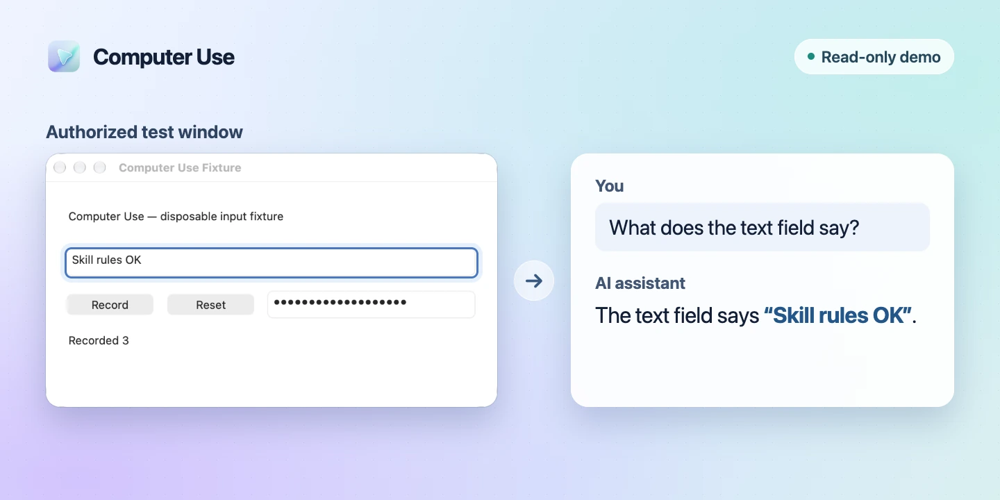

  

<h1 align="center">Computer Use</h1>

  <strong>让你正在用的 AI 助手帮你操作电脑</strong> 
  让它查看你授权的应用窗口，帮你点按钮、填表格。默认在后台操作。

  <strong><a href="https://github.com/starroyhq/computer-use/releases/latest">下载最新版</a></strong> ·
  <a href="README.en.md">English</a>

## 三步上手

1. **下载并打开 Computer Use。** 在下载页的 **Assets** 里，Apple 芯片 Mac（macOS 14+）选 `macos-arm64.dmg` 结尾的文件，将 App 拖到「应用程序」。Windows 选 `setup.exe` 结尾的安装包，Intel 或 AMD 电脑选 x64，Windows on ARM 选 ARM64。Windows 安装包暂未签名，可能出现[系统提示](docs/WINDOWS.md#安装与卸载)。
2. **连接你正在用的 AI 助手。** macOS 首次需要授予辅助功能和屏幕录制权限。在 App 的「接入」页点击「复制安装提示词」，粘贴给你的 AI 助手，由它安装接入所需的 Skill。配对请求出现时，在 App 里确认范围并批准。默认范围涵盖当前及之后打开的桌面应用和窗口，也可限定到指定应用。
3. **先试一次只读操作。** 打开记事本或 Mac 上的「文本编辑」，写一行测试文字，然后对 AI 助手说：「请用 Computer Use 读取我刚打开的测试窗口，告诉我里面写了什么。」

   
  只读任务演示 · 真实测试窗口与示例回复

你可以在 App 里随时暂停、撤销授权或紧急停止。

安装包已带齐运行组件。接入流程已在 Codex 上测试过。

## 更多帮助

[使用与排错](docs/USAGE.md) · [高级接入（Skill、MCP、CLI）](docs/USAGE.md#app--skill-双向接入--bidirectional-onboarding) · [npm / pnpm](docs/NPM.md) · [开发与构建](scripts/README.md) · [平台验证](docs/validation-results.md)

项目采用 [MIT 许可](LICENSE)，桌面能力基于 [Cua Driver](https://github.com/trycua/cua)。[第三方许可](THIRD_PARTY_NOTICES.md)
